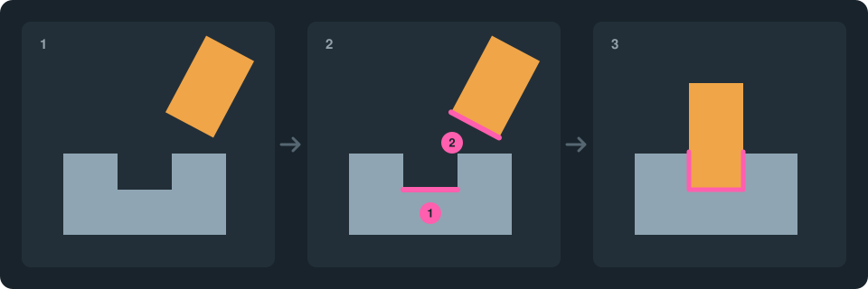
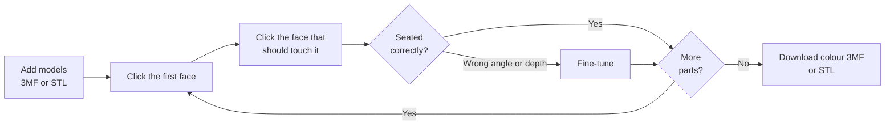
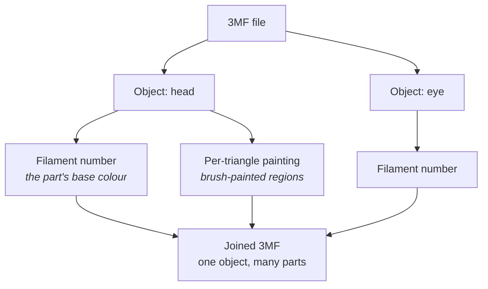
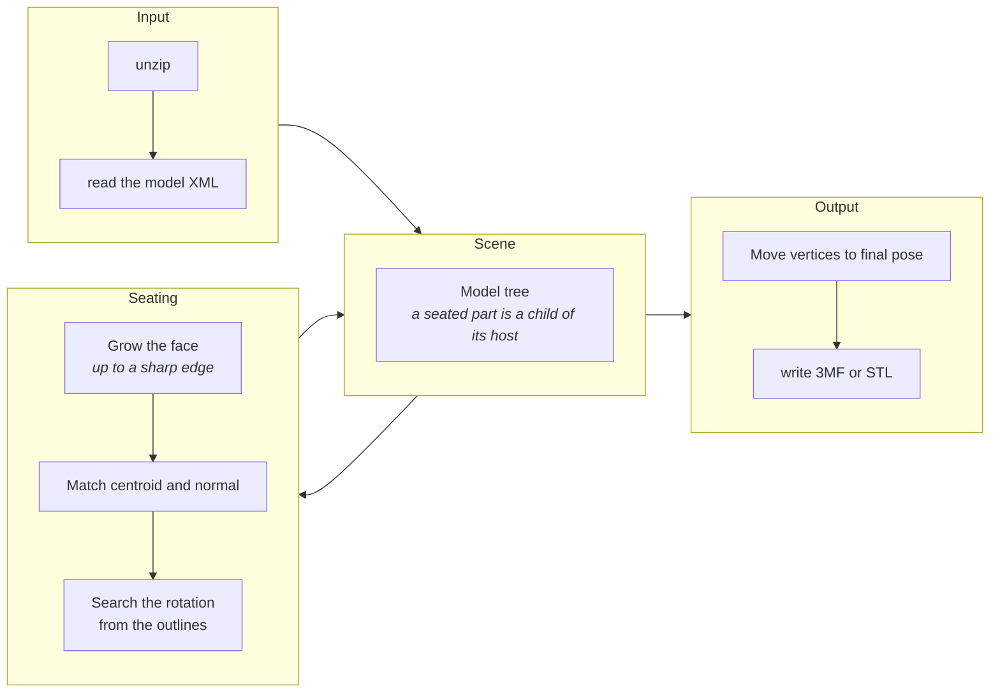

<div align="center">


# Parça Oturtucu

**Join multi-part 3D print models into one file by clicking the faces that should touch.**<br>
Filament assignments and brush painting in 3MF files are preserved. Nothing to install; it all runs in the browser.


[Türkçe](README.md) · **English**


[**Open the site →**](https://3mfstlbirlestirme.vercel.app)


</div>

## Why it exists

Figures from model sites often ship as separate pieces such as a head, arms and eyes. The designer made them to fit together, but in the file they all lie side by side on the plate. Parça Oturtucu ("Part Seater") seats those pieces in place and exports a file that opens as **one object** in the slicer.

<p align="center"></p>

<p align="center"><sub><b>1</b> Parts arrive apart · <b>2</b> You click the two faces that should touch · <b>3</b> The smaller one seats onto the larger</sub></p>

## Features

| | |
|---|---|
| **Two-click seating** | Click a face on one model, then the face that should touch it on another. Order does not matter; the smaller model moves. |
| **Part to part** | Parts seat onto the body and onto each other. Joined parts move as one group. |
| **Smart face picking** | The selection spreads until it reaches a sharp edge, so flat and gently curved faces are picked whole. |
| **Matching-spot suggestions** | Pick a face and the faces on other models whose area and outline match it light up green; pick a pupil and the socket in the eye white is suggested. |
| **Drag to rotate** | In rotate mode or holding <kbd>Alt</kbd>, drag: the part spins on its own axis and tilts. |
| **Multi-point seating** | Click more pairs between two seated parts (a pin tip and a hole floor, say); the part moves to the pose that best fits every point. |
| **Automatic rotation** | The angle is found from the two face outlines. On symmetric faces it warns you and you set it by hand. |
| **Fine-tuning** | Angle, embed depth, sideways and up/down offset, kept per joint. |
| **Colour preserved** | In 3MF, each part's filament number and brush painting are carried over exactly. |
| **3MF and STL** | Reads both, writes both. |
| **Privacy** | Models never leave the browser; nothing is sent to a server. |
| **Two languages** | Turkish and English interface. |

## How to use it



1. Load your files with **Add models**. Each object inside a 3MF arrives as its own model; the largest becomes the main model and stays put, the rest line up in front of it.
2. Click the mating face on one model, then the face that should touch it on the other.
3. If the parts have several connection points such as pins and holes, click those in pairs too, between the same two parts. Each pair adds a point to the joint and the part re-seats to fit them all.
4. Adjust the angle and embed depth in the **Fine-tune** panel if needed; you can type the angle as well.
5. **Download colour 3MF** or **Download STL**.

### Mouse and keyboard

| Gesture | Action |
|---|---|
| Click | Pick a face |
| <kbd>Shift</kbd> + click | Select a part |
| <kbd>Shift</kbd> + drag | Move a free part across the plate |
| Drag | Orbit the camera |
| Wheel | Zoom |
| Right-drag | Pan |
| <kbd>Alt</kbd> + drag | Spin (left/right) and tilt (up/down) the selected part; <kbd>Shift</kbd> for fine steps |
| <kbd>Esc</kbd> | Clear the selection |

On a touch screen, use the **Click: face / part** button in the view instead of <kbd>Shift</kbd>.

## How colours are preserved

Bambu Studio and OrcaSlicer project files store colour in two layers. The tool carries both over untouched; only the positions of the parts change.



In the output every part keeps its own filament number and painting. The source file's printer settings are left out by default, so your own printer and filaments stay in the slicer.

## Under the hood



- **Face picking.** Starts at the clicked triangle and spreads across neighbours while the angle between adjacent triangles stays under the threshold, set by the **Edge threshold** slider.
- **Alignment.** The area-weighted centroids of the two faces are matched and their normals turned to face each other. The one remaining freedom, the rotation, is searched as the angle that minimises the distance between the two face outlines.
- **Multi-point seating.** The first pair brings the two faces together and sets the plane. The centres of the later pairs are aligned in that plane by least squares; rotation and offset are fitted to all points together.
- **Model tree.** Each joint maps the child model's coordinates into its parent's. Moving a parent brings its children along; detaching a part only removes that joint.
- **File handling.** A 3MF is a zip; it is read and written with the browser's `CompressionStream` and `DecompressionStream`, with no extra library.

## Known limits

> [!IMPORTANT]
> The tool does **not perform a true boolean union.** Parts are pushed slightly into each other (0.1 mm by default) and written as separate bodies under one object. Slicers treat overlapping bodies as one solid, but the meshes stay separate in the file.

- **No spherical seating.** A ball-shaped part will not be placed correctly into a concave socket, such as an eyeball.
- **3MF support targets the Bambu Studio and OrcaSlicer project format.** Standard 3MF colour groups are not read.
- **A joined model may need more supports.** Parts are usually split so that each prints without them; joining everything is not always the best choice.
- **Models from different files** do not have their filament numbers remapped when joined.
- **Negative parts are not carved in the file.** They show as cavities on screen and you can seat parts inside them, but they are written to the 3MF as negative parts and the slicer does the actual carving. STL output leaves negative parts out.
- **Holes in the source mesh** are carried over as they are; the slicer's repair tool can fix them.

## Roadmap

- [ ] Spherical seating (ball and socket)
- [ ] True boolean union
- [ ] Filament remapping across files
- [ ] Support-need warning before download
- [ ] Reading standard 3MF colour groups

## Setup

No build step and no dependencies to install; the files are served as they are.

```
index.html        page skeleton
css/style.css     styles and theme colours
js/core.js        geometry, alignment, STL and 3MF reading/writing
js/i18n.js        English translations
js/app.js         interface, 3D view and interaction
docs/             icon and images
README.md         Turkish
README.en.md      this file
```

`js/core.js` does not depend on the browser or three.js, so it can be loaded and tested in Node. When you add interface text, add its English to `js/i18n.js`, keyed by the Turkish text.

- **Locally:** double-click `index.html` to open it in a browser, or run `npx serve` in the folder.
- **Vercel:** import the repository, choose "Other" as the framework and deploy with the default settings.

The page loads three.js r128 and its fonts from a CDN, so it needs an internet connection.

## Contributing

Open an issue for bugs and ideas. When reporting a bug, say which file you used, the order you clicked in and what happened; it makes the fix much faster.
