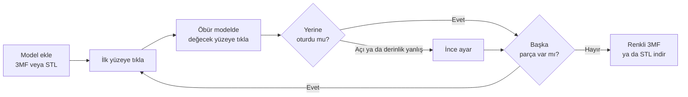
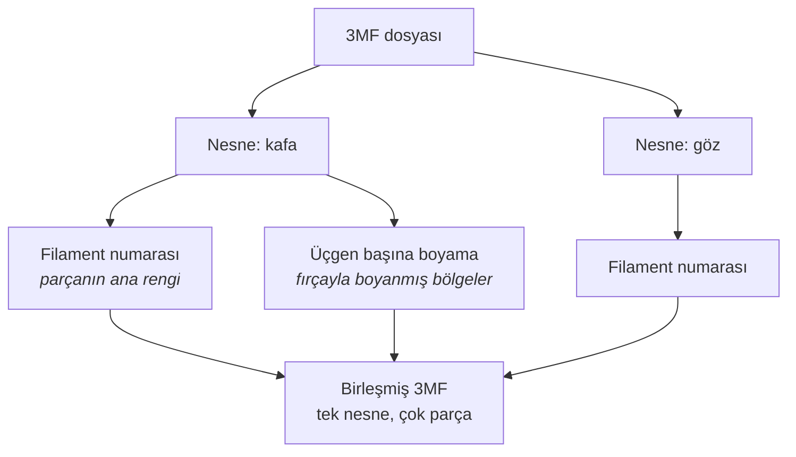
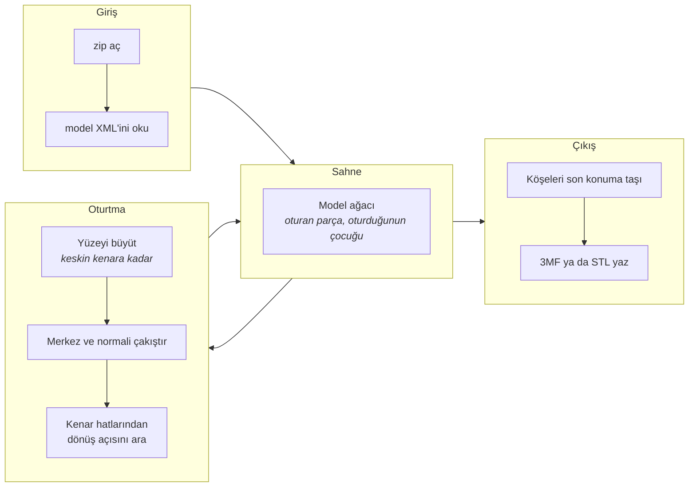

<div align="center">


# Parça Oturtucu

**Parça parça gelen 3B baskı modellerini, yüzeylerine tıklayarak tek dosyada birleştir.**<br>
3MF'teki filament atamaları ve fırça boyaması korunur. Kurulum yok, her şey tarayıcıda.


**Türkçe** · [English](README.en.md)


[**Siteyi aç →**](https://3mfstlbirlestirme.vercel.app)


</div>

## Neden var

Model sitelerinden inen figürler çoğu zaman kafa, kol, göz gibi ayrı parçalar halinde gelir. Tasarımcı parçaları birbirine oturacak şekilde yapmıştır, ama dosyada hepsi tablaya yan yana yatırılmış durur. Parça Oturtucu bu parçaları yerine oturtur ve dilimleyicide **tek nesne** olarak açılan bir dosya verir.

<p align="center"></p>

<p align="center"><sub><b>1</b> Parçalar ayrı gelir · <b>2</b> Birbirine değecek iki yüzeye tıklarsın · <b>3</b> Küçük olan büyüğe oturur</sub></p>

## Özellikler

| | |
|---|---|
| **İki tıkla oturtma** | Bir modelde yüzeye, öbüründe ona değecek yüzeye tıkla. Tıklama sırası fark etmez, küçük olan büyüğe gider. |
| **Parça parçaya** | Parçalar gövdeye de birbirine de oturur. Birbirine oturanlar tek grup olarak taşınır. |
| **Akıllı yüzey seçimi** | Seçim keskin kenara kadar yayılır; düz ve hafif eğri yüzeyleri tek tıkla bütün alır. |
| **Uyan yer önerisi** | Bir yüzey seçince, alanı ve dış hattı ona uyan yüzeyler başka modellerde yeşille işaretlenir; örneğin göz bebeğini seçince gözün beyazındaki yuva. |
| **Sürükleyerek döndürme** | Döndürme modunda ya da <kbd>Alt</kbd> basılıyken sürükle: parça kendi ekseninde döner ve eğilir. |
| **Çok noktalı oturtma** | Oturmuş iki parça arasında yeni çiftlere tıkla (pim ucu ve delik dibi gibi); parça bütün noktalara en iyi uyan konuma oturur. |
| **Otomatik açı** | Dönüş açısı iki yüzeyin kenar hatlarından bulunur. Simetrik yüzeylerde uyarır, elle ayarlarsın. |
| **İnce ayar** | Açı, gömme derinliği, yatay ve dikey kaydırma. Her oturtma için ayrı. |
| **Renk korunur** | 3MF'te her parçanın filament numarası ve fırça boyaması birebir taşınır. |
| **3MF ve STL** | İkisini de okur, ikisini de yazar. |
| **Gizlilik** | Modeller tarayıcıdan çıkmaz, sunucuya hiçbir şey gönderilmez. |
| **İki dil** | Türkçe ve İngilizce arayüz. |

## Nasıl kullanılır



1. **Model ekle** ile dosyalarını yükle. Bir 3MF'in içindeki her nesne ayrı model olarak gelir; en büyüğü ana model olur ve yerinde durur, diğerleri önüne dizilir.
2. Bir modelde oturma yüzeyine, sonra öbür modelde ona değecek yüzeye tıkla.
3. Parçada pim ve delik gibi birden fazla bağlantı noktası varsa, aynı iki parça arasında o noktalara da çift çift tıkla. Her çift bağlantıya nokta ekler ve parça bütün noktalara göre yeniden oturur.
4. Gerekirse **İnce ayar** panelinden açıyı ve gömmeyi düzelt; açıyı elle de yazabilirsin.
5. **Renkli 3MF indir** ya da **STL indir**.

### Fare ve klavye

| Hareket | Ne yapar |
|---|---|
| Tık | Yüzey seçer |
| <kbd>Shift</kbd> + tık | Parçayı seçer |
| <kbd>Shift</kbd> + sürükle | Serbest parçayı tabla üzerinde taşır |
| Sürükle | Kamerayı çevirir |
| Tekerlek | Yakınlaştırır |
| Sağ tık sürükle | Kamerayı kaydırır |
| <kbd>Alt</kbd> + sürükle | Seçili parçayı döndürür (sağa sola) ve eğer (yukarı aşağı); <kbd>Shift</kbd> ile ince adım |
| <kbd>Esc</kbd> | Seçimi kaldırır |

Dokunmatik ekranda <kbd>Shift</kbd> yerine görünümdeki **Tıklama: yüzey / parça** düğmesini kullan.

## Renkler nasıl korunur

Bambu Studio ve OrcaSlicer proje dosyalarında renk iki katmanda saklanır. Araç ikisini de olduğu gibi taşır; yalnızca parçaların konumu değişir.



Çıktıda her parça kendi filament numarasını ve boyamasını korur. Kaynak dosyanın yazıcı ayarları varsayılan olarak taşınmaz; böylece dilimleyicide kendi yazıcın ve kendi filamentlerin kalır.

## İçeride ne oluyor



- **Yüzey seçimi.** Tıklanan üçgenden başlar, komşu üçgenler arasındaki açı eşiğin altında kaldıkça yayılır. Eşik **Kenar eşiği** kaydırıcısıyla ayarlanır.
- **Hizalama.** İki yüzeyin alan ağırlıklı merkezi çakıştırılır, normalleri karşı karşıya getirilir. Kalan tek serbestlik olan dönüş açısı, iki yüzeyin sınır hatları arasındaki mesafeyi en aza indiren açı olarak aranır.
- **Çok noktalı oturtma.** İlk çift iki yüzeyi yüz yüze getirir ve düzlemi belirler. Sonraki çiftlerin merkezleri o düzlemde en küçük kareler yöntemiyle hizalanır; dönüş ve kayma bütün noktalara birlikte uydurulur.
- **Model ağacı.** Her oturtma, çocuk modelin koordinatlarını ebeveyninkine taşıyan bir bağlantıdır. Ebeveyn taşınınca çocukları da gelir; bir parçayı ayırmak yalnızca o bağlantıyı siler.
- **Dosya işleme.** 3MF bir zip'tir; tarayıcının `CompressionStream` ve `DecompressionStream` arayüzleriyle, ek kütüphane olmadan açılıp yazılır.

## Bilinen sınırlar

> [!IMPORTANT]
> Araç **gerçek kaynaştırma (boolean union) yapmaz.** Parçalar birbirine hafifçe gömülür (varsayılan 0,1 mm) ve tek nesne altında ayrı gövdeler olarak yazılır. Dilimleyiciler üst üste binen gövdeleri tek katı olarak dilimler, ama dosyanın içinde ağlar ayrıdır.

- **Küresel oturtma yok.** Top şeklinde bir parçayı çukur bir yuvaya (örneğin göz küresi) doğru yerleştirmez.
- **3MF desteği Bambu Studio ve OrcaSlicer proje biçimi içindir.** Standart 3MF renk grupları okunmaz.
- **Birleşen model daha çok destek isteyebilir.** Parçalar çoğu zaman desteksiz basılsın diye ayrılmıştır; hepsini birleştirmek her zaman en iyi seçim değildir.
- **Farklı dosyalardan gelen modeller** birleşince filament numaraları yeniden eşleştirilmez.
- **Negatif parçalar dosyada oyulmaz.** Ekranda oyuk olarak gösterilir ve içine parça oturtulabilir, ama 3MF'e negatif parça olarak yazılır; gerçek oymayı dilimleyici yapar. STL çıktısında negatif parçalar atlanır.
- **Kaynak ağdaki delikler** aynen taşınır; dilimleyicinin onarım aracıyla düzeltilebilir.

## Yol haritası

- [ ] Küresel oturtma (top ve çukur yuva)
- [ ] Gerçek boolean birleştirme
- [ ] Farklı dosyalar için filament eşleştirme
- [ ] İndirmeden önce destek ihtiyacı uyarısı
- [ ] Standart 3MF renk gruplarını okuma

## Kurulum

Derleme adımı ve bağımlılık kurulumu yok; dosyalar olduğu gibi sunulur.

```
index.html        sayfa iskeleti
css/style.css     stiller ve tema renkleri
js/core.js        geometri, hizalama, STL ve 3MF okuma/yazma
js/i18n.js        İngilizce çeviriler
js/app.js         arayüz, 3B görünüm ve etkileşim
docs/             ikon ve görseller
README.md         bu dosya
README.en.md      İngilizce
```

`js/core.js` tarayıcıya ve three.js'e bağlı değildir; Node'da da yüklenip test edilebilir. Yeni bir arayüz metni eklerken İngilizcesini `js/i18n.js` dosyasına, Türkçe metni anahtar olarak ekle.

- **Yerelde:** Klasörü tarayıcıda açmak için `index.html` dosyasına çift tıkla; ya da klasörde `npx serve` çalıştır.
- **Vercel:** Depoyu içe aktar, framework olarak "Other" seç, ayar değiştirmeden yayınla.

Sayfa açılırken three.js r128'i ve yazı tiplerini CDN'den çeker; çalışması için internet gerekir.

## Katkı

Hata bildirimi ve öneriler için bir issue aç. Hata bildirirken hangi dosyayla, hangi sırayla tıkladığını ve ne olduğunu yazman çözümü hızlandırır.
